# 基于 GPT-2 的中文评论文本生成模型微调与实验分析

## 摘要

本实验以中文评论文本生成为任务，采用 Hugging Face 平台上的中文 GPT-2 预训练语言模型，使用 ChnSentiCorp 评论数据完成部分参数微调。在 Windows 环境下，依托 NVIDIA GeForce GTX 1650 显卡，选取 1000 条训练评论和 200 条验证评论，冻结大部分预训练参数，仅更新最后一个 Transformer 层和最终归一化层，训练 2 个 Epoch。实际模型参数量为 102.07M，可训练参数量为 7,089,408。实验结果显示，验证集交叉熵损失由 3.1572 降至 2.9975，困惑度由 23.5040 降至 20.0353，下降 14.76%；在独立测试集的 1200 条评论上，损失由 3.1367 降至 2.9767，困惑度由 23.0276 降至 19.6222，下降 14.79%。训练后部分评论生成样例的语义一致性有所改善，但手机评论仍出现无意义英文字符序列，说明验证指标的改善不等同于生成质量全面提升。本实验完成了模型加载、数据预处理、参数微调、损失记录和文本生成对比的完整流程。

**关键词：** GPT-2；中文评论；语言模型；部分参数微调；困惑度；文本生成

## 1 实验目的与基本原理

### 1.1 实验目的

利用预训练中文语言模型实现评论文本续写，掌握从语料准备、Tokenizer 编码、网络训练到生成效果分析的实验流程。通过训练前后在同一验证集上的交叉熵损失及困惑度比较，分析领域语料微调的效果，并在独立测试集上检验评价结论，结合固定提示词下的生成样例考察其实际表现。

### 1.2 GPT-2 自回归语言建模

GPT-2 采用基于因果掩码的 Transformer 解码器，利用已有 token 预测后续 token。对于长度为 $T$ 的序列，联合概率表示为：

$$
P(x_1,\ldots,x_T)=\prod_{t=1}^T P(x_t\mid x_1,\ldots,x_{t-1})
$$

模型以有效预测位置上的平均交叉熵损失作为训练目标，其中 $N$ 表示参与损失计算的有效预测位置数量：

$$
\mathcal{L} = -\frac{1}{N}\sum_{t=1}^{N}\log P_{\theta}(x_t \mid x_1,\ldots,x_{t-1})
$$

训练中将 Padding 部分的标签置为 `-100`，使其不计入损失；GPT-2 模型内部完成标签与预测位置的错位对齐。验证集困惑度定义为：

$$
\mathrm{PPL}=\exp(\mathcal{L}_{\mathrm{val}})
$$

PPL 越低，通常表示模型在相同评估语料和计算方式下具有更好的下一个 token 预测能力，但并不直接衡量文本连贯性、真实性或表达质量。

## 2 模型与中文评论语料

### 2.1 预训练模型

模型使用 `uer/gpt2-chinese-cluecorpussmall`，通过 `BertTokenizer` 和 `GPT2LMHeadModel` 加载。该模型采用 12 层 Transformer Block；实际加载并统计得到总参数量 **102.07M**，权重文件约 421MB。加载后模型成功部署到 CUDA 设备。

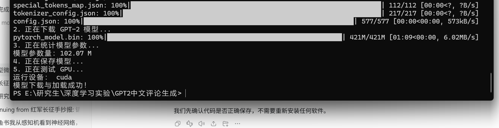

*图1 预训练模型参数统计及 CUDA 加载结果（实际运行截图）*

模型来源：<https://huggingface.co/uer/gpt2-chinese-cluecorpussmall>

### 2.2 数据来源与构建

评论语料来自 `lansinuote/ChnSentiCorp`，该数据集包含文本与情感标签。本实验针对文本生成，只读取 `text` 字段，不将情感标签作为训练目标。

实际执行的数据处理包括：清理多余空白、筛除长度小于 10 个字符的文本、按随机种子 42 打乱数据，分别从原始 `train` 与 `validation` 划分中选取 1000 条与 200 条，保存为 JSONL 格式。两部分样本分别来自原有数据划分。独立测试阶段进一步使用原始 `test` 划分，依照相同清洗条件保留 1200 条评论；测试数据不参与训练或训练期间验证。实际使用的处理脚本**未额外执行跨集合去重**，这一点在复现实验时应保持一致。

| 数据用途 | 数量 | 数据文件 |
|---|---:|---|
| 训练集 | 1000 | `data/train.jsonl` |
| 验证集 | 200 | `data/validation.jsonl` |
| 独立测试集 | 1200 | 原始 `test` 划分（评估时读取） |

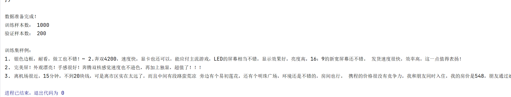

*图2 评论数据处理完成后的样本统计和内容示例（实际运行截图）*

数据来源：<https://huggingface.co/datasets/lansinuote/ChnSentiCorp>

### 2.3 Tokenizer 与训练样本

使用与预训练模型匹配的中文 `BertTokenizer` 编码文本，按最大 **64 tokens** 截断、填充，并添加结束标记。输入中实际有效位置的 `attention_mask` 为 1、填充位置为 0。标签中填充位置设置为 `-100`，以免填充内容参与交叉熵统计。

## 3 实验环境与参数配置

### 3.1 实验环境

| 项目 | 实际配置 |
|---|---|
| 操作系统 | Windows |
| 开发环境 | PyCharm |
| GPU | NVIDIA GeForce GTX 1650，4096 MiB 显存 |
| NVIDIA 驱动 | 516.54 |
| Python | 3.10.11（项目 `.venv`） |
| PyTorch | 1.13.1+cu117 |
| Transformers | 4.30.2 |
| Datasets | 2.14.7 |
| NumPy | 1.24.4 |
| 模型加载设备 | CUDA |

### 3.2 微调策略和超参数

为降低训练过程中梯度和优化器状态占用，冻结模型的全部参数后，仅开放**第 12 个 Transformer Block**及**最终 LayerNorm**参与训练。实测可训练参数为 **7,089,408**，约占 102.07M 总参数的 **6.95%**；这属于部分参数微调，并非全参数训练或 LoRA。

| 参数 | 实际设置 |
|---|---:|
| 训练轮数 | 2 Epoch |
| 每设备 Batch Size | 1 |
| 梯度累积步数 | 8 |
| 有效 Batch Size | 8 |
| 最大输入长度 | 64 tokens |
| 学习率 | $5\times10^{-5}$ |
| 优化器 | AdamW |
| 随机种子 | 42 |
| 训练批次步数 | 2000 |
| 参数优化步数 | 250 |

说明：这里“2000 步”指模型处理的训练批次；每累积 8 个批次更新一次参数，因此共进行 250 次优化器更新。由于每批仅包含 1 条评论，单步 Loss 随评论长度与内容差异产生较明显波动。

## 4 模型训练过程

### 4.1 训练流程

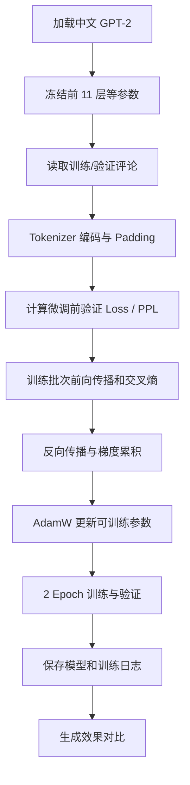

程序首先使用原始预训练模型计算验证集损失，作为基准；之后按训练批次记录 `train_loss`，每 25 个批次在 PyCharm 运行窗口输出一次 Loss，每个 Epoch 完成后执行验证。最终将微调后的权重保存至 `models/gpt2_finetuned`，将指标保存为 `results/metrics.json`，将逐步训练损失保存为 `results/train_loss.csv`。

核心冻结及参数选择逻辑如下：

```python
for p in model.parameters():
    p.requires_grad = False
for p in model.transformer.h[-1].parameters():
    p.requires_grad = True
for p in model.transformer.ln_f.parameters():
    p.requires_grad = True
optimizer = torch.optim.AdamW(
    (p for p in model.parameters() if p.requires_grad), lr=5e-5
)
```

核心反向传播和梯度累积逻辑如下：

```python
output = model(input_ids=input_ids,
               attention_mask=attention_mask, labels=labels)
loss = output.loss
(loss / 8).backward()
if (step + 1) % 8 == 0 or (step + 1) == len(train_loader):
    optimizer.step()
    optimizer.zero_grad()
```

### 4.2 训练过程与日志

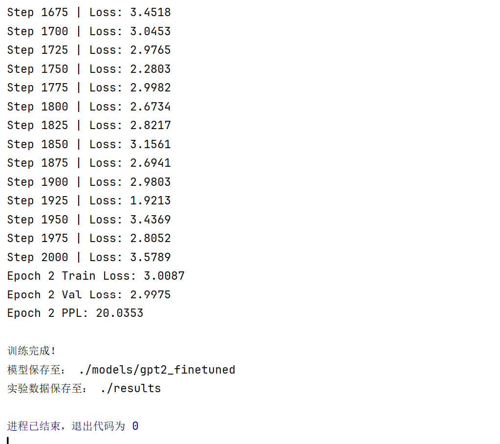

*图3 第 2 轮训练末尾日志、验证结果和权重保存信息（实际运行截图）*

从 `train_loss.csv` 读取 2000 条记录后，按 Epoch 分组计算训练批次损失均值，结果如下：

| 指标 | Epoch 1 | Epoch 2 |
|---|---:|---:|
| 平均训练 Loss | 3.1277 | 3.0087 |

第二轮的平均训练损失较第一轮低 0.1190，约降低 3.80%。这里的均值按 CSV 中每轮 1000 个训练批次的 Loss 取算术平均；它是训练期间的批次损失统计，并非训练集独立复评所得指标。

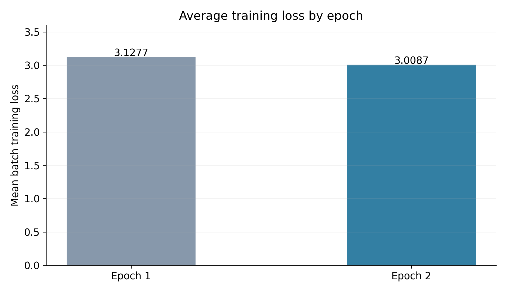

*图4 按原始 CSV 的 Epoch 字段对 1000 个批次损失求均值，数据取自本次实际训练记录*

### 4.3 训练损失曲线

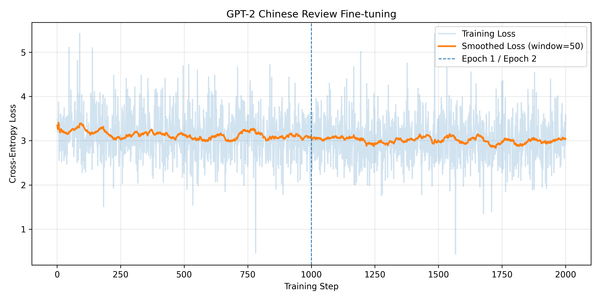

*图5 2000 个训练批次的原始 Loss 与 50 点滑动平均；虚线表示两个 Epoch 的分界（不是优化器更新步数）*

原始批次 Loss 波动较大，滑动平均曲线在初期下降后主要维持在 3 附近，并在第二轮出现较小幅度的波动。训练没有出现持续上升的损失发散现象。但由于验证指标仅在训练前和 Epoch 结束时计算，不能仅凭该训练曲线确定模型是否已充分收敛或是否存在过拟合。

## 5 实验结果与分析

### 5.1 验证集损失与困惑度

实测 `metrics.json` 记录如下：

| 指标 | 微调前 | 微调后 | 变化 |
|---|---:|---:|---:|
| 验证集交叉熵 Loss | 3.1572 | 2.9975 | 下降 0.1597 |
| 验证集 PPL | 23.5040 | 20.0353 | 下降 3.4688（14.76%） |

在验证集和损失计算方式保持一致的条件下，微调后交叉熵与困惑度均有所下降。这说明该模型对所选中文评论语料的下一个 token 预测能力有所提升。

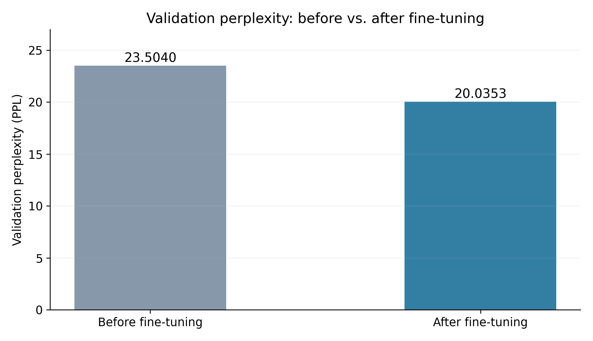

*图6 根据 metrics.json 的实测 PPL 绘制，数值越低表示同一验证集上的下一 token 预测困惑度越小*

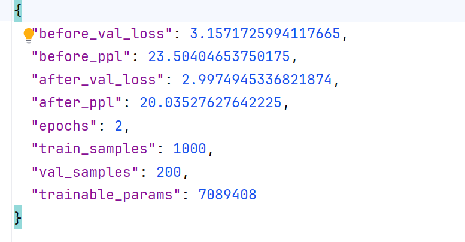

*图7 微调前后指标的 JSON 原始记录（实际运行截图）*

### 5.2 独立测试集评价

为检验模型在未参与训练及验证的数据上的预测表现，本实验另外读取 ChnSentiCorp 原始 `test` 划分，对清洗后保留的 **1200 条评论**进行独立评价。测试阶段不更新参数；微调前后使用相同的 Tokenizer、最大序列长度 64 tokens、Padding 掩码和有效 token 加权的损失统计方法。为避免 4GB 显存中同时驻留两份模型，评估时依次加载原始模型与微调模型。

| 评价指标 | 微调前 | 微调后 | 变化 |
|---|---:|---:|---:|
| 独立测试集交叉熵 Loss | 3.1367 | 2.9767 | 下降 0.1600 |
| 独立测试集 PPL | 23.0276 | 19.6222 | 下降 3.4054（14.79%） |

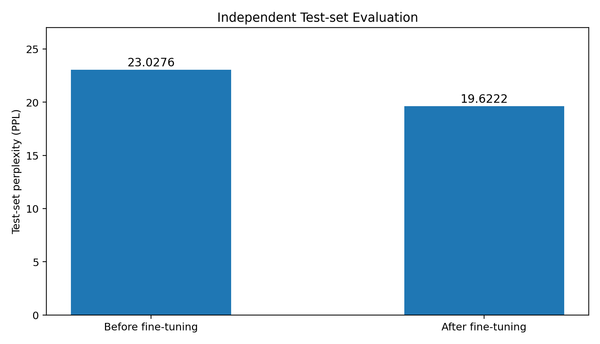

*图8 根据独立测试运行生成的 `test_metrics.json` 绘制；纵轴为测试集困惑度，数值越低表示预测损失越小。*

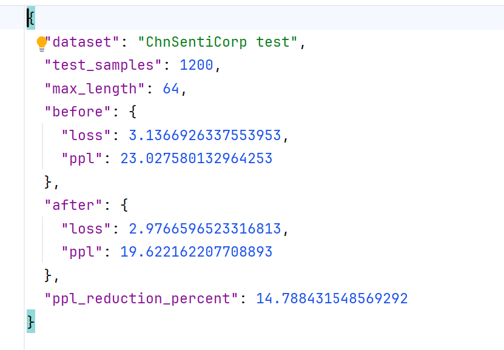

*图9 独立测试集 1200 条评论的评价结果（实际运行记录截图）。*

测试集 PPL 降幅为 **14.79%**，与验证集 **14.76%** 的降幅接近；微调后测试集 PPL 为 **19.6222**，验证集 PPL 为 **20.0353**。这表明本次微调带来的语言建模指标改善并非只出现在所选验证集上。由于验证集与测试集均来自 ChnSentiCorp，且本实验未进行跨语料库评价，仍不能把该结果推广到所有类型的中文文本或直接等同于人工主观生成质量提升。

### 5.3 固定提示词文本生成对比

微调前后分别使用同一组提示词，生成时设置 `max_new_tokens=40`、`top_k=50`、`top_p=0.9`、`temperature=0.8`、`repetition_penalty=1.2`，启用采样并设置随机种子为 42。以下文本将 Tokenizer 解码产生的汉字间显示空格合并，以便阅读；原始 JSON 文件保留未经处理的输出。

**样例 1：这家酒店的环境很好，**

- 微调前：这家酒店的环境很好，不错。但是服务也很差，那里有几个服务员都呆傻乎乎的，服务态度超级恶劣，让我印象深
- 微调后：这家酒店的环境很好，不错。服务也不错。的服务人员态度都很好，感觉非常舒服！酒店在东京和京都有一些

**样例 2：这款手机使用起来**

- 微调前：这款手机使用起来recovery.能否recovery.能否?????????????????????????????
- 微调后：这款手机使用起来还行.idswikiidswikizhikishorenswikisakiwikishorenswikisdwikidswi

**样例 3：这家餐厅的服务态度**

- 微调前：这家餐厅的服务态度很好，有点冷漠了！可能是因为开业太久了吧！菜品也不错~有水果沙拉和咖喱牛肉是主打
- 微调后：这家餐厅的服务态度很好，有点冷漠了！可能是因为开业太久了吧！菜品也不错~有水果沙拉和咖喱牛肉是主打

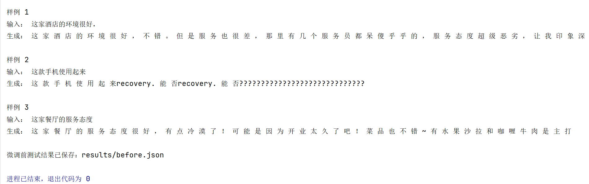

*图10 原始模型生成样例（实际运行截图）*

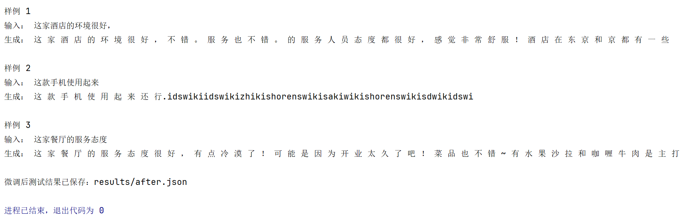

*图11 微调后生成样例（实际运行截图）*

三个提示词得到的变化并不相同：

- **酒店评论：** 微调前生成内容包含明显的服务负面评价，微调后输出转为相对一致的正面评价，局部语义更连贯；但仍有词语搭配不够自然的现象。
- **手机评论：** 微调前输出含 `recovery` 及连续问号，微调后虽然起始短句恢复了部分中文表达，但随后出现无意义英文字符序列。这一现象仍属于生成失败，不能视为改善。
- **餐厅评论：** 两次输出基本一致，且“态度很好”与“有点冷漠”并存，说明单次采样下仍存在语义矛盾；此样例未显示明显提升。

因此，验证集 PPL 的下降与部分文本样例的改善是一致的，但不能据此推出模型在所有生成场景下均有质量提升。三条生成实例属于定性分析，样本数量有限；严格评价生成质量还需要更多提示词和人工/自动评价指标。

### 5.4 评价口径与误差来源

验证集和独立测试集上的 Loss 均由模型逐批输出的 token 平均交叉熵加权汇总得到，权重为各批次参与预测的非填充 token 数；PPL 为该验证损失的指数。前后两次验证评价沿用同一 200 条验证评论，前后两次独立测试沿用同一 1200 条测试评论及相同编码方式，因此各自组内可以直接比较。

文本生成评价采用固定随机种子与相同采样超参数，但仅包含 3 条提示词；采样属于随机生成，固定随机种子不等于消除全部实验随机性。酒店评论的局部改善不能代表所有类型评论改善，手机评论中的英文乱码也不能归因于某个单一因素。尤其值得注意的是，两次餐厅续写完全相同，因此本次结果应区分“语言建模损失降低”与“生成表达质量提升”。

本实验已完成独立测试集的语言建模评价，但没有开展人工盲评或大规模生成质量评测；验证集与测试集的 Loss/PPL 下降不能直接代表生成语义、真实性和流畅性全面改善。三条提示词样例用于观察现象，不构成统计意义上的生成质量评价。

### 5.5 实验局限性

本实验微调语料规模仅为 1000 条训练评论，序列最大长度为 64 tokens，且仅更新约 6.95% 的参数。上述设置降低了资源需求，也限制了模型对评论场景的适应程度。由于中文 GPT-2 使用的词表与分词方式在生成时仍可能产生英文片段和重复内容，单靠本次小规模微调未能消除异常输出。损失指标侧重概率建模能力，无法直接衡量整段评论是否自然、真实和一致。

## 6 实验总结

本实验在 Windows 与 GTX 1650 显卡环境下，基于 102.07M 参数的中文 GPT-2 模型，完成了数据读取、文本编码、部分参数微调、模型保存以及生成对比测试。通过训练 2 个 Epoch，第二轮平均训练损失达到 3.0087，验证集损失从 3.1572 降至 2.9975，PPL 下降约 14.76%；独立测试集 Loss 从 3.1367 降至 2.9767，PPL 下降约 14.79%。两组相近的改进幅度为模型适应评论语料提供了进一步证据。实验验证了低显存设备上开展小规模中文预训练语言模型微调的可行性。文本生成对比同时表明，定量指标改善不意味着所有提示词下的输出都得到改善。后续可从扩大语料、改善生成策略以及增加独立生成质量评价等方面进一步研究。

## 7 实验复现与原始数据

### 7.1 目录与源码

实验归档同时提供 `code/`、`results/` 和 `images/`。其中 `code/` 收录依据本次实际运行步骤和本次对话中使用的代码整理的加载、语料准备、微调、生成及绘图脚本；`results/` 保存原始 JSON、CSV 与 Loss 曲线，`images/` 包含实验截图及由原始数值绘制的结果图。模型权重体积较大，不打包进提交文件，可根据 `code/load_model.py` 从公开仓库重建预训练模型，并运行训练代码重新生成微调权重。

复现顺序：`load_model.py` → `test_before.py` → `prepare_data.py` → `train.py` → `test_after.py` → `plot_loss.py` → `plot_metrics.py` → `test_independent.py`。运行目录应为项目根目录，使用 Python 3.10.11 和 CUDA 版 PyTorch 1.13.1。数据下载需要网络，微调模型重训结果可能受到 GPU 实现及采样随机性的影响。

### 7.2 关键原始记录的核查

`results/train_loss.csv` 包含 2000 行训练记录，Epoch 1 与 Epoch 2 各 1000 行；按 `epoch` 分组计算均值分别为 **3.1277** 和 **3.0087**。`results/metrics.json` 记录验证集前后 Loss 为 **3.1571725994** 和 **2.9974945337**，前后 PPL 为 **23.5040465375** 和 **20.0352762764**。`results/test_metrics.json` 记录独立测试集前后 Loss 为 **3.1366926338** 和 **2.9766596523**，前后 PPL 为 **23.0275801330** 和 **19.6221622077**。本报告的指标表与新增对比图均由这些原始文件计算，未添加预测性或模拟数据。

## 参考资料

[1] Radford A, et al. Language Models are Unsupervised Multitask Learners. OpenAI Technical Report, 2019. <https://cdn.openai.com/better-language-models/language_models_are_unsupervised_multitask_learners.pdf>

[2] Hugging Face. `uer/gpt2-chinese-cluecorpussmall`. <https://huggingface.co/uer/gpt2-chinese-cluecorpussmall>

[3] Hugging Face. `lansinuote/ChnSentiCorp`. <https://huggingface.co/datasets/lansinuote/ChnSentiCorp>

[4] Hugging Face. Transformers Documentation. <https://huggingface.co/docs/transformers/>

## 附录：实验结果文件

- `results/train_loss.csv`：逐批次训练损失，共 2000 行。
- `results/metrics.json`：微调前后验证 Loss、PPL 和可训练参数数值。
- `results/test_metrics.json`：1200 条独立测试评论的前后 Loss、PPL（数值根据用户提供的实际运行截图录入）。
- `images/test_metric_record.png`、`images/test_ppl_comparison.png`：独立测试结果截图和基于实测数据绘制的图表。
- `results/before.json`、`results/after.json`：同一提示词组下的生成原文。
- `images/loss_curve.png`：根据原始损失 CSV 绘制的曲线。
- `images/*.png`：来自实际 PyCharm 运行过程的截图。

